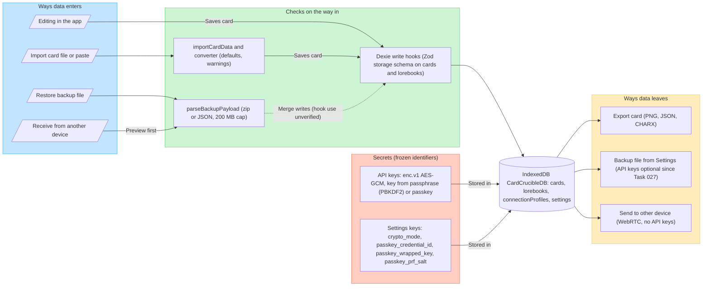

# Architecture

Three diagrams of how RoleplayForge is built. GitHub draws the Mermaid blocks; any AI can read them as text. Edges in diagrams 1 and 2 come from the `import` lines and function calls in `src/` read at `main` `48c6eae` (2026-10-30), except where a note below says otherwise. They are not a full call trace. If a diagram and the code disagree, the code wins; fix the diagram.

An editable FigJam copy exists on the owner's Figma board. It is a picture only; this file is the source.

## 1. App layers

No backend. Everything runs in the browser; the only network calls are to the model providers and to Chub (card import by URL). Since Task 028 no file under `src/components` imports the `db` object (a lint rule fails the build if one does), so screens read through the store; services, routing and `src/io` may use the database. Not re-checked since: how Chat and Test Lab save their data.

Notes:
- Free tools live in two places: `src/utils` (older: tokenizer, `writingLint`, `lorebookScan`) and `src/core` (newer: `chatMarkup`, `pasteImport`). Existing files are not moved (`PROJECT_STATE.md` Decision 2).
- `writingLint` is used only by the pre-flight audit modal.

## 2. Data safety

Frozen identifiers (do not rename): DB name `CardCrucibleDB`, settings keys, the `enc.v1.` format, passkey and sync identifiers (`PROJECT_STATE.md` Guardrails).

Open item (unverified): `src/io/backup.ts` has no schema check of its own (no Zod import found). Whether restore and device-sync writes go through the Dexie hooks on cards and lorebooks has not been checked in code. Hooks exist only on the `cards` and `lorebooks` tables; `connectionProfiles` and `settings` have none.

## 3. Delivery pipeline

A picture of `docs/AI_WORKFLOW.md`. That file is final and wins on any difference.

```mermaid
flowchart LR
    owner(["Owner: idea or problem"])
    plan["Claude plans and writes the task card"]
    card[/"Task card in docs/tasks"/]
    exec["Executor (ChatGPT or Muse, owner names one) codes on wip/NNN and opens PR"]
    ci{"CI test-and-lint green?"}
    stop["Executor stops and reports"]
    rev{"Card says Review required?"}
    review["Claude reviews PR diff"]
    merge["Executor squash-merges by hand"]
    deploy["Vercel deploys main (code commits only)"]
    ready{"Production deployment READY?"}
    recover["Manual deploy (Decision 22)"]
    done["Merged (executor deleted the card in the PR)"]
    sync["Claude syncs PROJECT_STATE"]
    check[/"Owner checks production on phone"/]

    owner --> plan
    plan --> card
    card -->|"Execute NNN"| exec
    exec --> ci
    ci -->|"No, fix (2 tries)"| exec
    ci -->|"Red after 2 fixes"| stop
    ci -->|"Yes"| rev
    rev -->|"Yes"| review
    rev -->|"No"| merge
    review -->|"Approved"| merge
    review -->|"Changes needed"| exec
    merge --> deploy
    deploy --> ready
    ready -->|"Yes"| done
    ready -->|"No"| recover
    recover --> done
    done --> sync
    sync --> check
    check -.->|"Problems become new cards"| owner

    style owner fill:#CDF4D3,stroke:#66D575
    style check fill:#CDF4D3,stroke:#66D575
    style plan fill:#DCCCFF,stroke:#874FFF
    style review fill:#DCCCFF,stroke:#874FFF
    style sync fill:#DCCCFF,stroke:#874FFF
    style exec fill:#C2E5FF,stroke:#3DADFF
    style merge fill:#C2E5FF,stroke:#3DADFF
    style stop fill:#FFCDC2,stroke:#FF7556
    style recover fill:#FFECBD,stroke:#FFC943
```

